# Arquitetura

O POJAE é uma Plataforma de Oportunidades para Jovens Aprendizes e Estagiários, desenvolvida para o CESMAC. O projeto segue MVC, com as regras de negócio concentradas na camada de service.

## Fluxo de uma requisição

```mermaid
flowchart LR
    Requisicao([Requisição]) --> Controller
    Controller --> Service
    Service --> Repository[Repository / Spring Data JPA]
    Controller -->|retorna| View[HTML / Tailwind / JavaScript]
    Controller -->|redireciona| Redirect[Redirect]
    View --> Resposta([Resposta])
    Redirect --> Resposta
```



## Controllers (`<app>/controller/`)

- Toda classe de controller usa `@Controller` ou `@RestController` do Spring MVC.
- Implemente apenas os métodos HTTP necessários (`@GetMapping`, `@PostMapping`).
<!-- - Anotações de controle de acesso do Spring Security, como `@PreAuthorize`, são permitidas. -->
- Não misture regras de negócio nem acesse o Spring Data JPA diretamente.
- O controller só recebe a requisição, chama o service e retorna a resposta (template ou redirect).
- O controller não contém regra de negócio nem acessa o Spring Data JPA diretamente.
<!-- - A autenticação e a sessão HTTP são gerenciadas pelo Spring Security ([ADR 0002](adr/0002-modelo-de-usuario-customizado.md)). -->

## Validações (`<app>/dto/`)

- Validam o formato da entrada e transportam os dados da requisição.
- A gravação é feita pelo service, sem gravação direta pelo controller.

## Services (`<app>/service/`)

- Toda regra de negócio fica aqui, incluindo validações de negócio e consultas ao Spring Data JPA.
- Services não recebem objetos de requisição HTTP nem retornam respostas HTTP.
- Falhas são comunicadas por exceções de domínio (`<app>/exception/`), que o controller converte em respostas HTTP.

## Entidades (`<app>/model/`)

- Definem campos, relacionamentos e metadados, sem regra de negócio.

## View

- Cuidam apenas da apresentação, sem lógica de negócio.

## Admin

- O painel administrativo em Spring Boot não deve ignorar as regras dos services: suas ações chamam os services, e a escrita fica bloqueada nas entidades cujas regras dependem deles.

## Exemplos

Leitura:

```java
@Controller
public class PostController {

    @Autowired
    private final CandidateService service;

    @GetMapping("/candidatos")
    public String read(Candidate candidate) {
        return service.read();
    }

}
```

Alteração, com a exceção de domínio convertida em resposta HTTP:

```java
@Controller
public class CandidateController {
    
    @Autowired
    private final CandidateService Service;

    @PostMapping("/candidatos")
    public String create(@RequestBody Candidate candidate) {
        return service.create(candidade);
    }

}
```